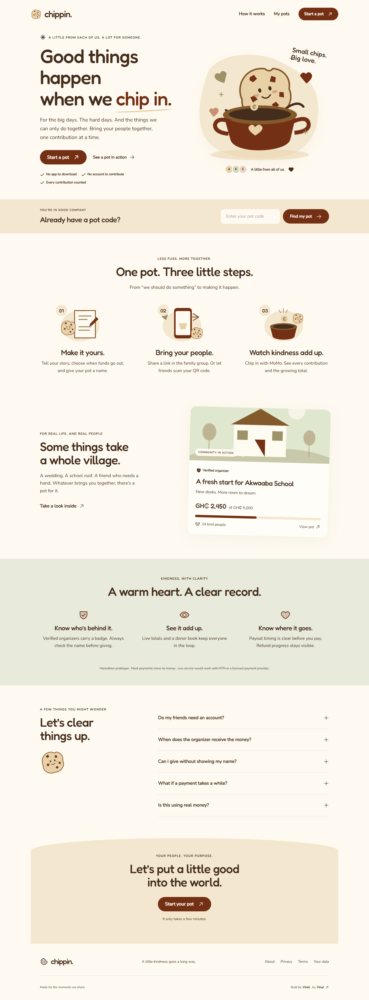
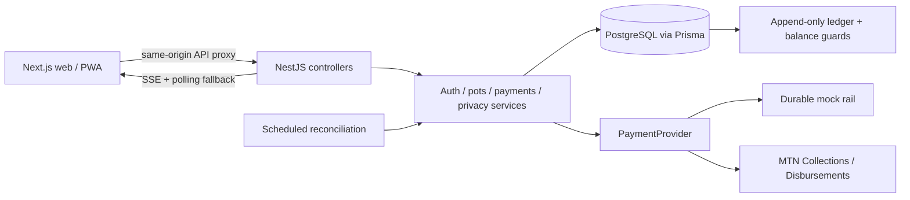

# Chippin

A little from each of us. A lot for someone.

Chippin turns a MoMo number in a WhatsApp group into a shared pot with a story, a live total, a donor book and clear payout timing. Built for the MTN MoMo Fintech Lab, Everyday Payments & Financial Access.



## Run locally

Requirements: Node 22, pnpm 10 and Docker Desktop running. On this Windows ARM machine, Prisma uses the PostgreSQL driver adapter and password hashing uses native `@node-rs/argon2`.

```sh
pnpm install
pnpm exec tsx scripts/local-setup.ts
pnpm --filter @chippin/shared build
pnpm db:generate
pnpm dev
```

Open **http://localhost:3000**. API health: **http://127.0.0.1:4000/health**. `pnpm dev` starts PostgreSQL, applies migrations, seeds mock data, then runs both apps. The first Docker image download may take several minutes.

Join pot **AKWAABA** to see the open school fundraiser. **TOGETHER** is closed and paid out. Organizer login: `ama@chippin.local`; read `DEMO_PASSWORD` from your ignored `.env`. Admin login: `ADMIN_EMAIL` and `ADMIN_PASSWORD` in `.env`. Passwords and encryption keys are generated locally and never committed. OTP codes appear in the API terminal only during local development. Public signup needs a configured SMS provider.

Mock mode moves no money. Choose success, declined, timeout or delayed success on the payment form. The mock provider persists transactions, so receipts and reconciliation survive server restarts. Sandbox uses **test EUR**, simulates outcomes and does **not** send a real handset approval prompt. Fake demo balances are never seeded in sandbox or live mode.

## Architecture



Money is integer pesewas. The balance is derived from immutable ledger entries less persisted reservations. Pot row locks serialize money mutations. Provider references and amounts cannot be rewritten. Unknown outcomes keep their references; confirmed failed transfers retry with new immutable attempt records and bounded backoff. Callbacks trigger a provider status query and never create money from their payloads.

Each database is bound to one provider environment at API startup. Use separate databases for mock, sandbox and live; the server refuses cross-environment reuse, and the seed script refuses to put demo balances into a sandbox/live database. Dashboard activity uses authenticated SSE with a polling fallback. Confirmed refunds queue SMS notices when Twilio is configured.

Before payout, cancellation queues individual refund transfers. After payout, recovery asks the organizer to approve returning money with request-to-pay. Refunds wait for confirmed recovery. The UI explains that Chippin cannot pull funds from a wallet.

## Checks

```sh
pnpm test
pnpm typecheck
pnpm contrast:check
pnpm assets:check
pnpm build
pnpm exec playwright install chromium
pnpm test:e2e
pnpm audit --prod --audit-level high
```

PostgreSQL must be running and migrated for the integration tests. On Windows you can use an installed Chrome browser: `$env:PLAYWRIGHT_CHANNEL='chrome'; pnpm test:e2e`. Browser tests cover code entry, successful/declined contributions, live donor book updates, mobile layout and enlarged text. Tests create isolated records in the local database; immutable ledger entries are deliberately not erased afterward.

## Environment

Start from [.env.example](.env.example). Do not regenerate encryption keys on an existing database.

| Variables                                                            | Purpose                                                                |
| -------------------------------------------------------------------- | ---------------------------------------------------------------------- |
| DATABASE_URL                                                         | PostgreSQL URL, TLS required for hosted database                       |
| PORT, WEB_URL                                                        | API port and exact allowed web origin                                  |
| API_URL                                                              | Next.js server-side proxy destination; no trailing slash               |
| NEXT_PUBLIC_API_URL                                                  | Reserved public API prefix; app uses same-origin `/api`                |
| NEXT_PUBLIC_WEB_URL                                                  | Public origin for metadata and social previews                         |
| MOMO_MODE                                                            | mock, sandbox or live                                                  |
| CURRENCY, MOMO_CURRENCY                                              | Mock/display denomination and provider test denomination               |
| MOMO_BASE_URL, MOMO_ENVIRONMENT                                      | Provider host and target environment                                   |
| MOMO_COLLECTION_SUBSCRIPTION_KEY, MOMO_DISBURSEMENT_SUBSCRIPTION_KEY | Product subscription keys                                              |
| MOMO_COLLECTION_USER, MOMO_DISBURSEMENT_USER                         | API user UUIDs                                                         |
| MOMO_COLLECTION_API_KEY, MOMO_DISBURSEMENT_API_KEY                   | API-user secret keys                                                   |
| MOMO_CALLBACK_URL                                                    | Public API origin plus `/callbacks`; reference is appended per request |
| PHONE_ENCRYPTION_KEY, PHONE_HASH_KEY                                 | Independent 32-byte hex keys for AES-GCM and HMAC                      |
| ADMIN_EMAIL, ADMIN_PASSWORD, DEMO_PASSWORD                           | Private seed credentials                                               |
| SMS_MODE                                                             | console for local dev, twilio for delivered OTP                        |
| TWILIO_ACCOUNT_SID, TWILIO_AUTH_TOKEN, TWILIO_FROM                   | SMS credentials and approved sender                                    |
| RETENTION_MONTHS                                                     | Default 24 months after closure and settlement                         |
| MAX_CONTRIBUTION_MINOR                                               | Default 500000; integer minor units                                    |
| REFUND_FEE_POLICY                                                    | Full refunds; zero contribution fee in this prototype                  |
| RECOVERY_WINDOW_HOURS                                                | Default 72 hours, then admin flag while still reconciling              |
| LIVE_PAYMENTS_ENABLED                                                | Must be true for live adapter activation after external review         |

## Sandbox and deployment

Follow [exact manual steps](docs/MANUAL_TASKS.md) for MTN credentials, public callback, Vercel, Render and hosted PostgreSQL. Run `pnpm exec tsx scripts/momo-sandbox-setup.ts` after providing your two subscription keys and callback URL. [MoMo notes](docs/MOMO_NOTES.md) distinguish verified documentation from the pending credential-backed smoke test.

API deployment uses [Dockerfile](apps/api/Dockerfile) and [render.yaml](render.yaml); web deployment uses [Vercel configuration](apps/web/vercel.json). No hosting accounts, Git remote or credentials were supplied, so **public deployment remains pending**.

## Submission and ownership

- [Three-minute demo](docs/DEMO_SCRIPT.md)
- [Pitch notes](docs/PITCH_NOTES.md)
- [Submission checklist](docs/SUBMISSION_CHECKLIST.md)
- [Privacy review](docs/PRIVACY_COMPLIANCE.md) and [breach response](docs/BREACH_RESPONSE.md)
- [Artwork inventory](docs/ASSETS.md) and [third-party licenses](docs/THIRD_PARTY.md)
- [Decisions](docs/DECISIONS.md)

The original artwork is included and marked PLACEHOLDER for replacement. Privacy Policy and Terms are drafts requiring Ghanaian legal review. Chippin makes no license claim. Live service would operate with MTN or a licensed payment provider.

MIT. Built by **Vinet**, by **[Vinyl](https://github.com/oldVinyl)**.
